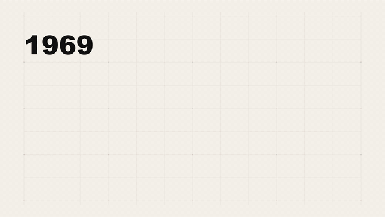
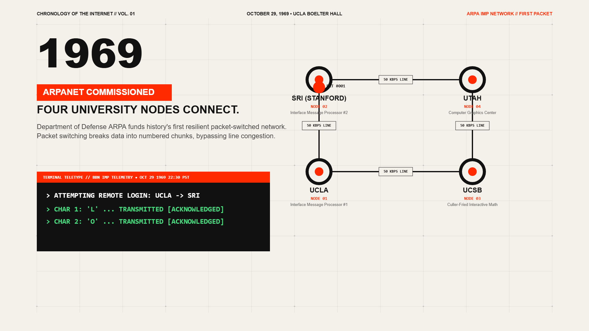
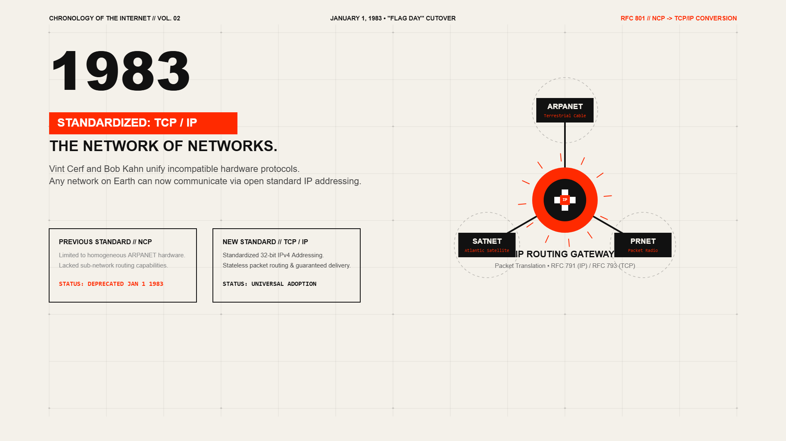
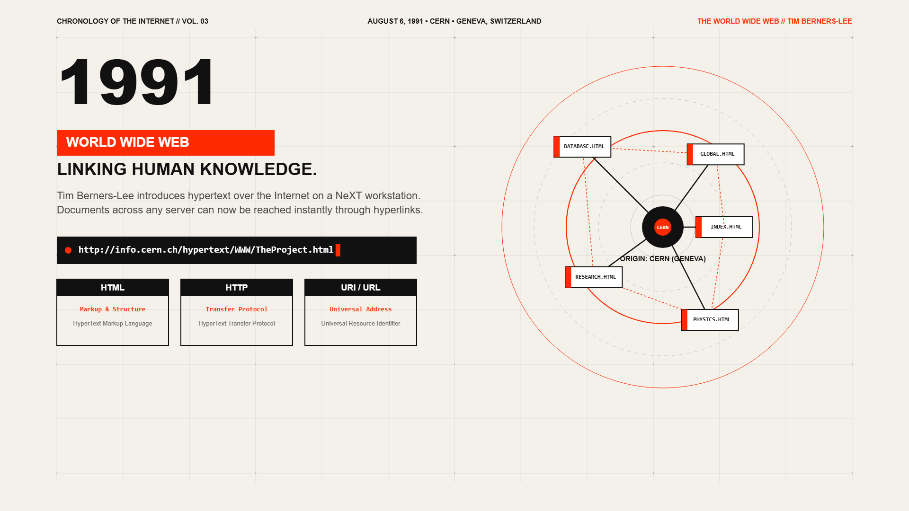
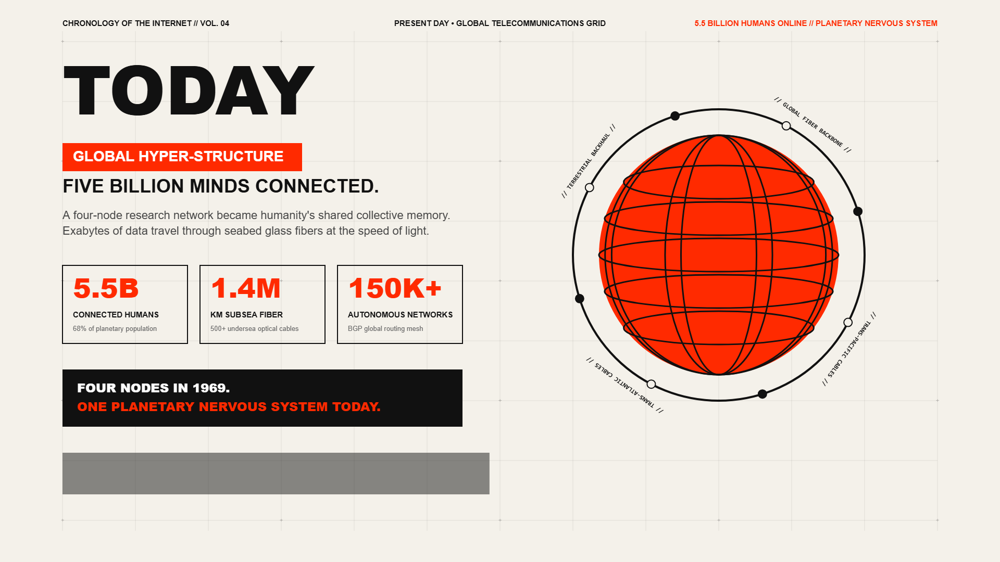

# 🎬 Antigravity-Opuscar (`ag-opuscar`)


**A toolbox of film styles made entirely in code — built & tuned for Google Antigravity IDE and Gemini Agents.**

Inspired by `lemomo-ai/lemo-opuscar`, **Antigravity-Opuscar** turns your coding agent into a full animation studio. Pick a visual style (or craft your own), bring your story or topic, and let Antigravity write deterministic HTML5 Canvas / WebGL / Three.js scenes, synthesize voiceover narration and procedural music, and compile a 1080p `.mp4` film via FFmpeg — **with zero video generation models or stock footage.**

---

## 🎥 Demo

A 31-second film, *History of the Internet*, in the `swiss-motion-graphics` style. Every frame, the voiceover and the music were produced by code in this repo.



▶️ [Watch the full-quality 1080p MP4 with voiceover and music](docs/demo/history-of-the-internet.mp4)

| 1969 — ARPANET | 1983 — TCP/IP |
| :---: | :---: |
|  |  |
| **1991 — World Wide Web** | **Today** |
|  |  |

The full source of this film lives in [`films/history-of-the-internet/`](films/history-of-the-internet/).

---

## ✨ Key Features for Antigravity

- **100% Deterministic Code Rendering**: Every frame is driven by `window.renderFrame(t, duration)` at an exact timestamp (`t`), ensuring zero frame drops or jitter regardless of hardware speed.
- **Native Antigravity Integration**:
  - `.agent/rules/opuscar-studio.md` — Studio rules auto-loaded by Antigravity.
  - `.agent/skills/ag-opuscar/SKILL.md` — Skill manifest for natural-language filmmaking.
  - `.agent/workflows/make-film.md` & `.agent/workflows/make-style.md` — Slash-command workflows (`/make-film`, `/make-style`).
  - `AGENTS.md` & `GEMINI.md` — Root agent instructions optimized for Gemini's coding strengths.
- **Built-in Production Pipeline (`core/` & `tools/`)**:
  - 🎨 **Picture**: Headless Chromium (Playwright) frame-by-frame capture (`1920x1080` @ `24fps` default, or vertical `1080x1920`).
  - 🎙️ **Voice**: Neural text-to-speech via `edge-tts` with automatic word/scene timing alignment.
  - 🎵 **Music**: Procedural Python synthesizer (`core/music_engine.py`) that composes ambient, rhythmic, or cinematic stems in pure code.
  - 🎞️ **Mix & Verify**: FFmpeg loudness normalization (`loudnorm`), audio ducking, subtitle burn-in, and automated frame/audio verification (`core/verify.py`).

---

## 🚀 Quick Start in Antigravity

### 1. Prerequisites
Ensure you have:
- **Python 3.10+**
- **Node.js 18+** (optional, for advanced Three.js bundling)
- **FFmpeg** installed and available in your system `PATH` (`ffmpeg -version`)

### 2. Install Dependencies
Open the terminal in Antigravity and run:

```bash
# Linux / macOS
bash setup.sh

# Windows (PowerShell / CMD)
setup.bat
```

Or manually:
```bash
pip install -r requirements.txt
playwright install chromium
```

### 3. Make Your First Film
In the Antigravity Agent chat, simply type:

> *"Make a 30-second film in the `cyber-network-hud` style about how TCP 3-Way Handshake works. Use a confident narrator."*

Or trigger the workflow directly:
> `/make-film`

Want to test the rendering engine immediately without prompting? Run the included demo project:
```bash
python tools/build_film.py --project films/history-of-the-internet/project.json
```

---

## 🎨 Included Seed Styles (`styles/`)

| Style ID | Visual Aesthetic | Technique Base | Best For |
| :--- | :--- | :--- | :--- |
| `swiss-motion-graphics` | Stark grid, bold typography, signal red (`#FF2A00`), beat-synced geometry | 2D HTML5 Canvas | Explainers, manifestos, brand intros |
| `cyber-network-hud` | Dark telemetry terminal, glowing packet routing, live data graphs | 2D Canvas + Procedural Glow | Tech, networking, cybersecurity, AI |
| `watercolor-storybook` | Organic pigment washes, warm paper texture, gentle pan & fade | Multi-layer 2D Canvas + SVG Filters | Stories, history, biographies, nature |
| `isometric-3d-diorama` | Orthographic 3D blocks, soft shadows, smooth camera orbits | Three.js (WebGL) | Architecture, systems, product tours |
| `evidence-documentary` | Archival documents, highlighter sweeps, sourced data counters | HTML/CSS DOM + Canvas Overlay | Journalism, case studies, finance |
| `chalkboard-lecture` | Slate blackboard, animated stroke-by-stroke chalk drawings & formulas | SVG Path `strokeDashoffset` + Canvas | Education, math, algorithms, physics |

---

## 🛠️ Studio Architecture

| File / Folder | Role |
| :--- | :--- |
| `DIRECTOR.md` | How the agent directs: story arcs, pacing, shot transitions, narration timing, and self-checks. |
| `TECHNIQUE.md` | How the agent writes code: deterministic `window.renderFrame(t)` contract, DPI scaling, audio mixing. |
| `MY-STYLES.md` | 5-step interactive workflow to customize a library style or build a new one in `my-styles/`. |
| `core/` | Python engine for Playwright frame capture, `edge-tts` voice generation, procedural music, and FFmpeg mixing. |
| `tools/` | CLI utilities (`init_project.py`, `preview_frame.py`, `build_film.py`) invoked by the Antigravity agent. |
| `styles/` | Style prompt (`STYLE.md`) + runnable reference template (`demo.html`) for each visual style. |
| `films/` | Output workspace where each film project (`project.json`, scenes, audio, final `.mp4`) lives. |

---

## 🧰 Troubleshooting

| Problem | Fix |
| :--- | :--- |
| `ffmpeg: command not found` | Install FFmpeg (`sudo apt install ffmpeg`, `brew install ffmpeg`, or `winget install ffmpeg`) and reopen the terminal. |
| Playwright cannot find Chromium | Run `python -m playwright install chromium`. |
| No voiceover generated | `edge-tts` needs an internet connection to reach its speech service. |
| Build is slow | Rendering is frame-by-frame at an exact timestamp, so long or 1080p films take a while. Preview a single frame first with `tools/preview_frame.py`. |

---

## 🗺️ Roadmap

- [ ] More seed styles (blueprint, retro CRT, paper-cut)
- [ ] Vertical (1080×1920) sample film for Shorts / Reels
- [ ] Optional subtitle styles
- [ ] A one-command `make demo`

Ideas are welcome. Please open an issue.

---

## 🤝 Contributing

New styles, scenes and bug fixes are welcome. See [CONTRIBUTING.md](CONTRIBUTING.md).

## 🙏 Acknowledgements

Inspired by [`lemomo-ai/lemo-opuscar`](https://github.com/lemomo-ai/lemo-opuscar). Voice synthesis uses [`edge-tts`](https://github.com/rany2/edge-tts), rendering uses [Playwright](https://playwright.dev/), and mixing uses [FFmpeg](https://ffmpeg.org/).

## 📄 License

[MIT](LICENSE)
